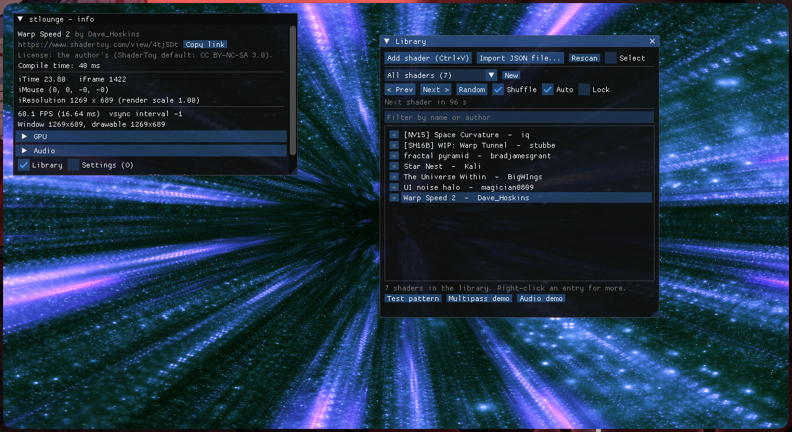
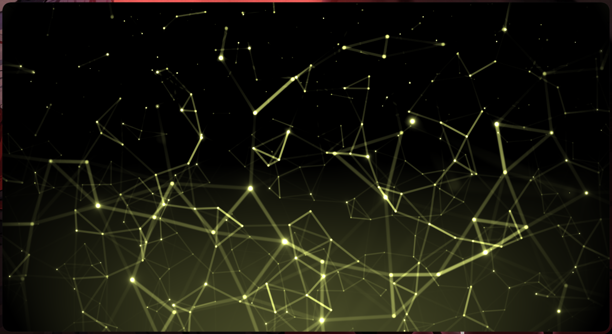

# stlounge

 

A lightweight Linux player for [ShaderToy](https://www.shadertoy.com) shaders, meant to be left
running as eye candy: playlists, shuffle, crossfades, and shaders that react to whatever your
desktop is playing.

- **Runs ShaderToy shaders natively** on OpenGL ES 3 (Wayland or X11), including multipass
  buffers, textures, cubemaps, mouse input and desktop audio.
- **A shader library** with playlists, favorites, shuffle, auto-advance, crossfade and lock.
- **Safe to leave running:** shaders that fail to compile, crash the driver or are too slow for
  your GPU are skipped instead of taking the desktop down.
- **Small:** about 11 MB including textures, no browser engine.



## Contents

- [Quick start](#quick-start)
- [Install](#install)
- [Adding shaders](#adding-shaders)
- [Playing shaders](#playing-shaders)
  - [Keyboard shortcuts](#keyboard-shortcuts)
- [Settings](#settings)
- [Audio](#audio)
- [Troubleshooting](#troubleshooting)
- [Differences from shadertoy.com](#differences-from-shadertoycom)
- [Safety nets](#safety-nets)
- [Where files are stored](#where-files-are-stored)
- [For developers](#for-developers)
- [License](#license)

## Quick start

1. Download the AppImage and run it (see [Install](#install)).
2. On shadertoy.com, export a shader's JSON with a browser extension (such as the [ShaderToy unofficial plugin](https://github.com/patuwwy/ShaderToy-Chrome-Plugin)).
3. Copy the JSON and press **Ctrl+V** in the app. The shader starts playing.
4. Press **H** to hide the interface and **F** for fullscreen.

## Install

### AppImage (recommended)

Download `stlounge-<version>-x86_64.AppImage`, make it executable and run it:

```sh
chmod +x stlounge-*-x86_64.AppImage
./stlounge-*-x86_64.AppImage
```

Requirements:
- A GPU driver (NVIDIA or Mesa) with OpenGL ES 3.0 through EGL. Every current desktop driver
  has it.
- A glibc at least as new as the one on the machine that built the AppImage.

### From source

Dependencies on Arch:

```sh
sudo pacman -S base-devel cmake ninja pkgconf sdl2 libpulse nlohmann-json mesa libglvnd
```

Build and run:

```sh
cmake -S . -B build -G Ninja
cmake --build build
./build/stlounge                 # --help for options
sudo cmake --install build       # optional: installs to /usr/local
```

## Adding shaders

Open a shader on shadertoy.com and export its JSON with a browser extension. Then either:

- copy the JSON and press **Ctrl+V** in the app,
- drop the files onto the window, or
- use **Library > Import JSON file** (several files at once work).

You can also write your own: the **Add shader** dialog has a tab per pass and a channel picker
for each `iChannel`, and you can paste GLSL code into the Image tab. To change a shader later,
right-click it in the Library and pick **Edit...**.

> **Why not just paste a shadertoy.com link?** The site blocks programs with a Cloudflare
> browser check, so the app can't download shaders directly.

## Playing shaders

The **Library** window plays a playlist:

- **All shaders**
- **Favorites**: click the `*` next to a shader.
- **Your own playlists**: right-click a shader > **Add to playlist**.

Click any shader to play it. With the UI hidden, the shader fills the window with nothing on
top.

### Keyboard shortcuts

| Key | Action |
|---|---|
| Space | Pause / resume |
| N or Right | Next shader |
| P or Left | Previous shader |
| R | Random shader |
| S | Shuffle on/off |
| L | Lock: no auto-advance or transitions |
| H or Tab | Hide / show the UI |
| Esc | Leave fullscreen, then hide / show the UI |
| F or F11 | Fullscreen |
| F5 | Reload the shader |
| O | Settings |
| Ctrl+V | Add a shader |
| F12 | Screenshot to `~/Pictures/stlounge/` (no UI) |

## Settings

Press **O** to open them.

| Section | Options |
|---|---|
| Display | FPS cap, render scale |
| Playlist | Auto-advance interval, shuffle, lock, crossfade (off by default: it renders two shaders during the fade) |
| Audio | Which output to listen to |
| Textures | Your own images instead of the built-in textures |
| Advanced | Frame-time limit, compile-time cap |

To give one shader its own play time, right-click it > **Play time**.

## Audio

Shaders with a music, microphone or SoundCloud input react to your desktop audio. The app
listens to your default output (PulseAudio or PipeWire), or to the output chosen in
**Settings > Audio**. Capture only runs while the current shader uses it.

## Troubleshooting

| Problem | What to do |
|---|---|
| A shader crashes or freezes the app at start | Run with `--safe-mode`, then fix or delete the shader in the Library. The [crash guard](#safety-nets) usually handles this for you. |
| Black screen or no window | Run with `--verbose` and check the first lines (video driver, GL renderer and version). Try `SDL_VIDEODRIVER=x11` or `SDL_VIDEODRIVER=wayland`. |
| No audio reaction | Check **Settings > Audio** and that the shader has an audio input. The info panel's Audio section shows the capture state. |
| A shader looks different than on the site | See [Differences from shadertoy.com](#differences-from-shadertoycom). |

The log is in `~/.local/state/stlounge/stlounge.log` (the previous run's is `stlounge.log.old`).

**Command-line options:**

| Option | Effect |
|---|---|
| `--safe-mode` | Start with a test pattern instead of the last shader |
| `--verbose` | Print debug messages in the terminal |
| `--version` | Show the version |
| `--help` | List all options |

## Differences from shadertoy.com

ShaderToy runs shaders in a browser through WebGL 2. stlounge runs them on your GPU driver
directly, so some shaders behave differently:

- **Noise or flicker:** WebGL sets every variable to zero; native drivers don't. A shader that
  reads a variable before writing it can show garbage.
- **Different results or compile errors on some drivers:** each driver has its own compiler and
  handles edge cases (NaN, division by zero, `pow` of negative numbers, etc.) its own way. The
  compile log points at the right tab and line.
- **Not supported:** keyboard, webcam and video inputs, Cubemap A buffers, and sound shaders
  (`mainSound`). The app tells you when a shader uses one; it still runs, with a black texture
  in its place.
- **Audio** comes from your desktop rather than the shader's own track.

For shader authors: the audio texture uses ShaderToy's 512x2 layout, `HW_PERFORMANCE` is 1,
`iFrameRate` is the measured rate, and `iChannelTime` follows `iTime`.

## Safety nets

- **Compile errors:** the log is shown with ShaderToy's tab names and line numbers. The
  previous shader keeps running, and playlists skip the broken one.
- **Crash guard:** if the app or the desktop dies during a shader's first second, that shader is
  flagged on the next start. It's skipped and shown in red in the Library; click it to try again.
- **Frame-time limit:** a shader that takes more than 1 s per frame can freeze the whole
  desktop, so it's skipped. Adjust in **Settings > Advanced** (0.2 to 10 s, or off).
- **Compile-time cap** (optional, **Settings > Advanced**): gives up on shaders that take too
  long to compile, when the driver compiles in the background.
- **Broken files** (settings, playlists, library entries) produce a warning, not a crash. An
  unreadable settings file is saved as `settings.json.bad` before being replaced.

## Where files are stored

| What | Where |
|---|---|
| Settings | `~/.config/stlounge/settings.json` |
| Shader library, playlists, your textures | `~/.local/share/stlounge/` |
| Log, last session, crash marker, UI layout | `~/.local/state/stlounge/` |
| Screenshots | `~/Pictures/stlounge/` |

Each library shader is a standard ShaderToy JSON file, so you can use it elsewhere. The app's
own data (favorite, play time) is kept in a separate `"stlounge"` key.

## For developers

### Tests

```sh
ctest --test-dir build --output-on-failure
```

No display is needed. GPU tests use Mesa's software renderer and are skipped if no OpenGL ES
context can be created.

For a sanitizer build:

```sh
cmake -B build-asan -DCMAKE_BUILD_TYPE=Debug -DCMAKE_CXX_FLAGS="-fsanitize=address,undefined"
cmake --build build-asan
ASAN_OPTIONS=detect_leaks=0 ctest --test-dir build-asan --output-on-failure
```

### Building the AppImage

```sh
./packaging/build-appimage.sh            # --clean for a fresh build, --help for options
```

The result is `build-appimage/stlounge-<version>-x86_64.AppImage`.

- It needs `linuxdeploy` and `appimagetool`. If they aren't installed, the script downloads
  them into `build-appimage/tools/` (`--no-download` prevents this). To pin them, add their
  SHA-256 to `packaging/appimage-tools.sha256`; the script prints the lines to add.
- GPU driver libraries are never bundled; the script fails if one slips in.
- The AppImage only runs on systems with a glibc at least as new as the build machine's. Built
  on an up-to-date Arch, that rules out most non-rolling distributions; for wider
  compatibility, build in an older distribution (for example an Ubuntu 22.04 container).

### Packaging

`packaging/aur/PKGBUILD` builds the AUR package from a tagged release. Distribution packages
should configure with `-DSP_USE_SOURCE_ASSETS=OFF`, so the binary only looks for its textures
in `<prefix>/share/stlounge` and doesn't carry the build folder's path.

### Code layout

| Folder | Contents |
|---|---|
| `src/app/` | Main loop, UI panels, guards |
| `src/shadertoy/` | ShaderToy wrapper, JSON, renderer |
| `src/gfx/` | GL helpers |
| `src/textures/`, `src/audio/`, `src/library/`, `src/config/`, `src/platform/`, `src/ui/` | Their namesakes |
| `third_party/` | Dear ImGui and stb |

To change the app icon, edit `assets/icons/icon.svg`, then run `packaging/render-icons.sh`
(needs `rsvg-convert`) and commit the regenerated PNGs.

## License

- **Code:** MIT, see `LICENSE`.
- **Third-party code:** see `third_party/VERSIONS.md`. Dear ImGui and stb are MIT / public
  domain. The AppImage also bundles SDL (zlib) and libpulse (LGPL-2.1+) as shared libraries.
- **Shaders** belong to their authors (ShaderToy's default license is CC BY-NC-SA 3.0). The
  app ships no shaders and shows each shader's author and link.